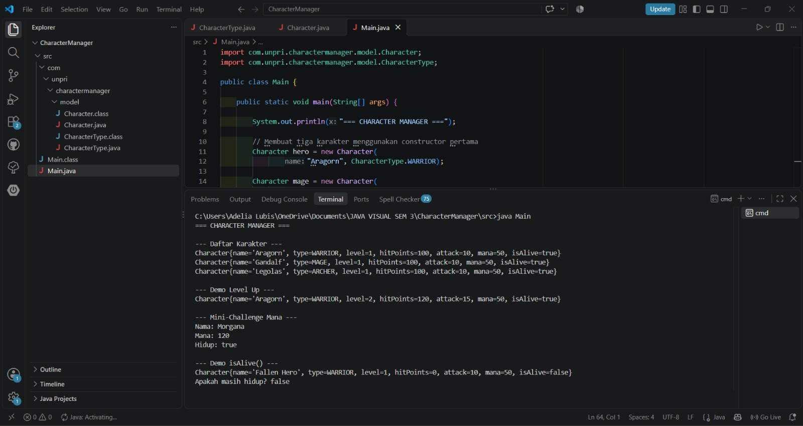

# Character Manager – TP3 (Java Visual SIH-6406)

## Deskripsi Project

Character Manager adalah program Java sederhana untuk mengelola karakter game. Program ini menerapkan konsep Object-Oriented Programming (OOP), seperti class, object, constructor, encapsulation, dan enum.

Project ini dikembangkan untuk memenuhi tugas TP3 Java Visual dengan menambahkan fitur mana dan pemeriksaan status hidup karakter menggunakan method `isAlive()`.

## Fitur Program

- Membuat tiga karakter game: Aragorn, Gandalf, dan Legolas.
- Menampilkan informasi karakter melalui method `toString()`.
- Menggunakan enum `CharacterType` untuk menentukan jenis karakter.
- Mengubah level karakter dan memperbarui atribut terkait.
- Mengatur jumlah mana menggunakan getter dan setter.
- Memvalidasi nilai mana agar tidak negatif.
- Memeriksa apakah karakter masih hidup menggunakan method `isAlive()`.
- Menampilkan demonstrasi fitur karakter melalui terminal.

## Teknologi yang Digunakan

- Java
- JDK 17
- Visual Studio Code
- Git dan GitHub

## Screenshot Output

Berikut adalah screenshot hasil eksekusi program Character Manager di terminal.



## Struktur Project

```text
CharacterManager/
├── src/
│   └── com/
│       └── unpri/
│           └── charactermanager/
│               └── model/
│                   ├── Character.java
│                   └── CharacterType.java
├── Main.java
├── README.md
└── image.png
```

## Identitas Mahasiswa

- **Nama:** Florentina Lubis
- **NIM:** 253303621213
- **Kelas:** 3 Pagi A
- **Link Google Docs:** [Klik di sini untuk membuka dokumen analisis](https://docs.google.com/document/d/1y7fefQY8ZbgYm6_hfz_NKU0HnQCZaz7MJDivuxyH4Eg/edit?usp=sharing)