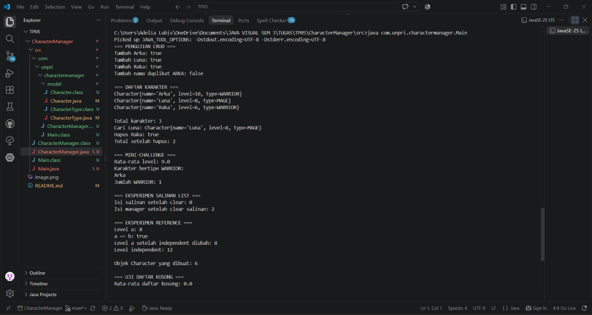
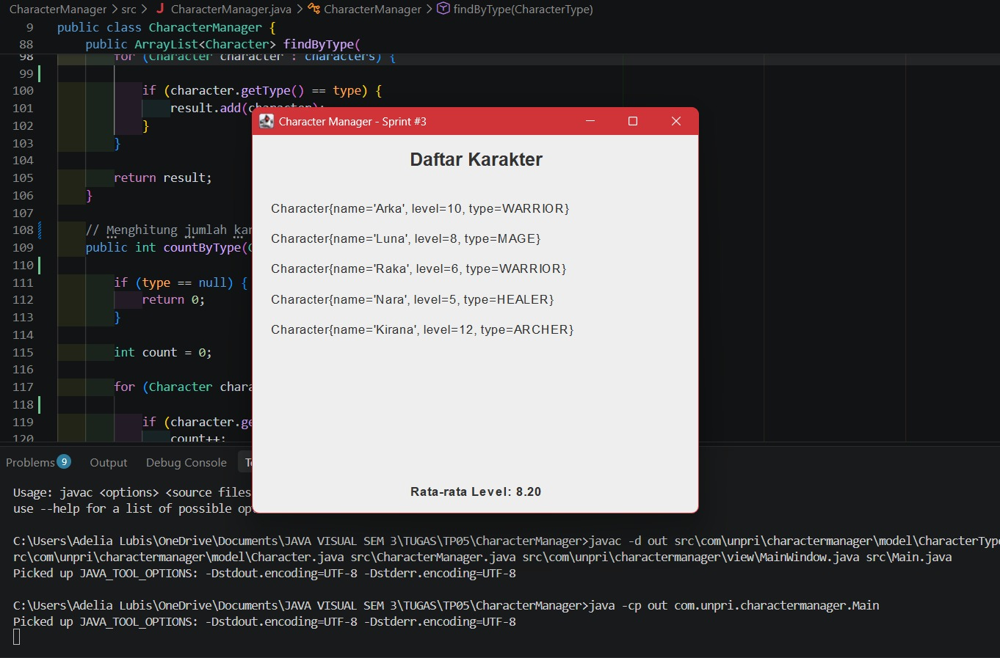
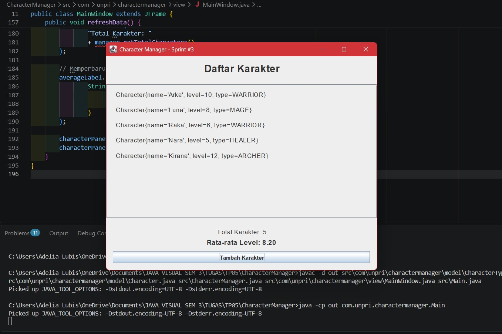

---

# TP5 — CharacterManager

## A. Implementasi Core

Pada TP5, program CharacterManager dikembangkan menggunakan Java
dengan menerapkan konsep Object-Oriented Programming (OOP).

Fitur yang diimplementasikan:

1. `equals()` membandingkan nama karakter.
2. `addCharacter()` menambahkan karakter jika nama belum terdaftar.
3. `findByName()` mencari karakter berdasarkan nama.
4. `removeCharacter()` menghapus karakter berdasarkan nama.
5. `getTotalCharacters()` menghitung jumlah karakter dalam daftar.
6. `getAllCharacters()` mengembalikan salinan daftar karakter.

Penambahan karakter dengan nama yang sama ditolak agar tidak terjadi
duplikasi data. Perbandingan nama dilakukan tanpa membedakan
huruf besar dan kecil.

## B. Mini-Challenge

### 1. getAverageLevel()

Method ini menghitung rata-rata level seluruh karakter.
Jika daftar kosong, method mengembalikan `0.0` sehingga tidak terjadi
pembagian dengan nol.

### 2. findByType()

Method ini mencari semua karakter berdasarkan tipe yang dipilih
dan mengembalikan hasilnya dalam bentuk `ArrayList` baru.

Kedua method telah disiapkan untuk diuji melalui `Main.java`.

## C. Fitur Analitik Tambahan: countByType()

Saya menambahkan method `countByType(CharacterType type)` untuk
menghitung jumlah karakter berdasarkan tipe tertentu.

Contohnya, pemanggilan `countByType(CharacterType.WARRIOR)`
menghasilkan jumlah karakter yang bertipe WARRIOR.

Fitur ini membantu pengguna mengetahui komposisi karakter
berdasarkan tipe tanpa harus menghitungnya secara manual.

Method ini hanya mengembalikan angka hasil perhitungan, bukan
ArrayList internal. Dengan demikian, encapsulation tetap dijaga
karena daftar karakter tidak diberikan secara langsung kepada pemanggil.

## D. Pengujian Program

Pengujian dilakukan melalui `Main.java` untuk memastikan bahwa
fitur program berjalan sesuai rancangan.

Hasil pengujian yang perlu dibuktikan:

- Penambahan karakter berhasil.
- Nama karakter duplikat ditolak.
- Pencarian dan penghapusan karakter berjalan dengan benar.
- Rata-rata level dapat dihitung.
- Pencarian karakter berdasarkan tipe menghasilkan daftar yang sesuai.
- Daftar hasil `getAllCharacters()` dapat dikosongkan tanpa
  menghapus isi daftar asli.
- Eksperimen reference menunjukkan bahwa dua variabel dapat
  mengacu pada objek yang sama.

### Screenshot Output 

## E. Analisis Reference dan Rancangan

Dokumen Google Docs:
[https://docs.google.com/document/d/1K7m3kqIU0gGmnvwtrTMJYH3ozOtxvCdgWcvRzcSZ5SU/edit?usp=sharing]

Analisis membahas reference objek, primitive value, variabel static,
implementasi equals(), dan encapsulation pada method getAllCharacters().

## F. Kesimpulan

Melalui TP5, saya mempelajari pengelolaan objek Java, pencegahan
data duplikat, pembuatan salinan daftar, serta analisis perilaku
reference. Saya juga menambahkan fitur analitik untuk menghitung
jumlah karakter berdasarkan tipe dan menguji implementasinya
melalui program utama.

## TP8 — Character Manager Sprint #3

### A. Implementasi MainWindow

MainWindow merupakan GUI berbasis Java Swing yang menampilkan
daftar karakter secara dinamis. Jendela menggunakan JFrame,
sedangkan JPanel dan JLabel digunakan untuk menyusun informasi
karakter serta statistik rata-rata level.

### B. Data Dinamis dan Mini-Challenge

Program menampilkan minimal lima karakter melalui perulangan.
Statistik rata-rata level dihitung berdasarkan seluruh data
karakter yang dikelola oleh CharacterManager. Ketika data berubah,
tampilan dan statistik diperbarui agar tetap sesuai.

### C. Screenshot

#### Sebelum Perubahan

#### Sesudah Perubahan

### D. Alur Data dan MVC

Main membuat objek CharacterManager dan menyiapkan data karakter.
CharacterManager mengelola koleksi karakter serta menyediakan
perhitungan rata-rata level. MainWindow mengambil data tersebut
dan menampilkannya menggunakan komponen Swing. Pembagian ini
mendukung prinsip MVC karena pengelolaan data dan tampilan
memiliki tanggung jawab yang berbeda.

### Karakter Baru

| Nama | Tipe | Level | Alasan |
|---|---|---:|---|
| Gimli | WARRIOR | 15 | Mewakili karakter petarung |
| Arwen | MAGE | 20 | Menambah variasi karakter |

### Google Docs — Analisis GUI dan MVC

[Tempelkan link Google Docs Bagian D di sini](https://docs.google.com/document/d/1-jqboEXK6qoWMB0FwT9pNbAtHx-jIm4G1cgsdyxsMtA/edit?usp=sharing)

## TP10 — Character Manager Sprint #4

### A. Implementasi Tema
Aplikasi menggunakan `AppTheme.java` untuk mengatur warna, font, dan border agar tampilan konsisten. Warna kartu karakter disesuaikan dengan role masing-masing. Karakter dengan level minimal 5 ditampilkan dengan teks tebal berwarna emas.

### B. Properti Tambahan
1. **Tooltip karakter:** menampilkan nama, role, dan level ketika pengguna mengarahkan kursor ke kartu karakter.
2. **Penonaktifan level 1:** karakter dengan level 1 dinonaktifkan untuk membedakannya dari karakter yang sudah berkembang.

### C. Screenshot

**Sebelum perubahan (Sprint #3)**

)

**Sesudah perubahan (Sprint #4)**

)

### D. Analisis MVC
Pengaturan tampilan ditempatkan di `AppTheme.java` dan `MainWindow.java` karena keduanya merupakan bagian dari View. Sementara itu, `Character` tetap berfungsi sebagai Model yang menyimpan data karakter, seperti nama, level, dan role. Pemisahan ini membuat kode lebih mudah dirawat dan perubahan desain tidak mengharuskan perubahan struktur data karakter.

### E. Google Docs
Link analisis properti dan MVC: **[https://docs.google.com/document/d/1Qvs1BCR-A1_fuWY_5GIL0TsltsbO51DlbijHHL1sEAU/edit?usp=sharing]**
